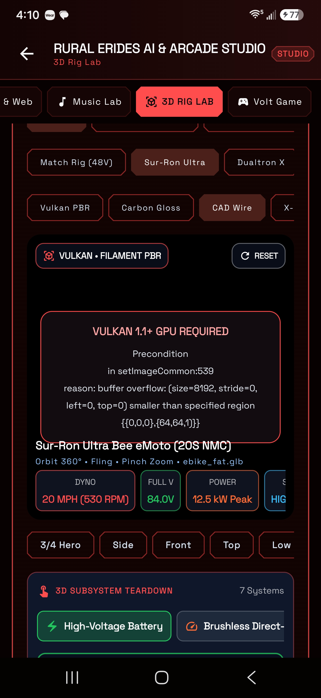
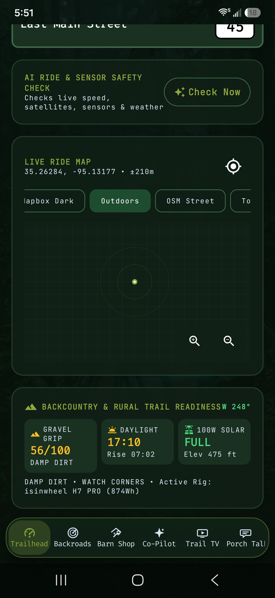
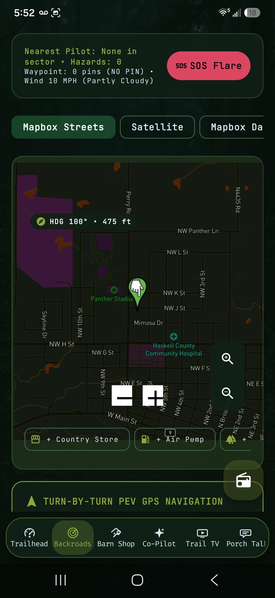

<p align="center">
  
</p>

<h1 align="center">Rural Erides GO</h1>

<p align="center">
  <strong>Country Backroads PEV Cockpit • GPS Mission HUD • 3D Rig Lab • Rider Radar • Porch Talk</strong>
</p>

<p align="center">
  <a href="https://play.google.com/store/apps/details?id=com.aistudio.volttrail.kqrmvx">
    
  </a>
  
  
  
</p>

---

**Rural Erides GO** is an Android cockpit and backcountry companion built for Electric Unicycles (EUCs), Sur-Ron / e-motos, hyperscooters, and gravel e-bikes. Designed for county roads, farm lanes, and off-grid trails, it combines real-time hardware telemetry, multi-engine 3D vehicle inspection, live Rider Radar, AI mechanical diagnostics, and an automatic seasonal holiday theme engine.

---

## App Previews

<p align="center">
  
  &nbsp;&nbsp;
  
  &nbsp;&nbsp;
  
</p>

---

## Key Features

- **Mission-Locked GPS HUD & Speed Limits** — When you start a ride mission, the speedometer and live speed-limit indicator lock against accidental scrolling while keeping essential ride telemetry and the integrated YouTube Music deck accessible.
- **Multi-Engine 3D Rig Lab (30+ Models)** — Inspect PEV models and chassis blueprints using **OpenGL ES 3.0 PBR**, **WebGL 2.0 GLB**, **Blueprint CAD**, and **Compose 3D GPU Mesh** engines.
- **100% Compose Vector Ride Maps** — Review recorded routes with fast vector trail maps, elevation and speed telemetry curves, battery Wh/mi efficiency, and shareable mission cards.
- **Universal Seasonal Holiday Theme Engine** — Automatically decorates every screen with ornaments, banners, and badges for **New Year's Day**, **Valentine's Day**, **St. Patrick's Day**, **Easter**, **Memorial Day**, **4th of July**, **Labor Day**, **Halloween**, **Veterans Day**, **Thanksgiving**, and **Christmas**.
- **Privacy-First Rider Radar & Porch Talk** — Your live location beacon stays **off by default** until you choose to broadcast. Coordinate trail rides with P2P Walkie-Talkie and share updates on the Porch Talk community board.
- **Gemini Vision AR Mechanic & 80+ Calculators** — Camera-assisted mechanical troubleshooting, tire/battery/range calculators, maintenance reminders, and a live versioned Change Log & Diagnostics hub in **About App**.
- **Cloud Sync & Dual Auth** — Google Sign-In via Jetpack Credential Manager backed by Firebase Firestore & Firebase AI Logic.

---

## Download & Install

### Option 1: Public Download Landing Page (GitHub Pages)
Visit the public Rural Erides GO landing page at [https://bradley3398.github.io/Rural-ERides-GO-V2/](https://bradley3398.github.io/Rural-ERides-GO-V2/) (deployed from [`public/index.html`](public/index.html)). It automatically pulls the latest signed APK, file size, and changelog from GitHub Releases.

### Option 2: Direct APK from GitHub Releases
1. Open the [Releases page](https://github.com/bradley3398/Rural-ERides-GO-V2/releases/latest) on [github.com/bradley3398/Rural-ERides-GO-V2](https://github.com/bradley3398/Rural-ERides-GO-V2) and download the latest signed `app-release.apk`.
2. Tap the downloaded APK on your Android device (Android 8.0+).
3. Allow your browser to install apps if prompted, then launch **Rural Erides GO**.

### Option 3: Google Play Store
- Package ID: `com.aistudio.volttrail.kqrmvx`
- Store listing: [Rural Erides GO on Google Play](https://play.google.com/store/apps/details?id=com.aistudio.volttrail.kqrmvx)

---

## Automated CI/CD: Signed Releases, Google Play & Public Pages

This repository includes two GitHub Actions workflows:

### 1. Signed Android Release & Automatic Google Play Upload
Workflow: [`.github/workflows/android-release-sign.yml`](.github/workflows/android-release-sign.yml)

Pushing any version tag matching `v*` (for example, `git tag v46.0 && git push origin v46.0`) automatically:
1. Decodes your production upload keystore from GitHub Secrets (never committed to the repo).
2. Builds and signs both the release **App Bundle (`.aab`)** and **APK (`.apk`)**.
3. Verifies signatures with `jarsigner` and `apksigner` and blocks debug-signed builds.
4. Publishes a **public GitHub Release** with the signed `.apk` and `.aab` attached.
5. Uploads the signed `.aab` automatically to **Google Play Console** (`com.aistudio.volttrail.kqrmvx`).

#### Required GitHub Actions Secrets
Configure these under **Settings → Secrets and variables → Actions**:

| Secret Name | Description |
| :--- | :--- |
| `KEYSTORE_BASE64` | Base64-encoded production upload `.jks` / `.keystore` file |
| `KEYSTORE_PASSWORD` | Keystore password |
| `KEY_ALIAS` | Upload key alias inside the keystore |
| `KEY_PASSWORD` | Private key password for `KEY_ALIAS` |
| `PLAY_SERVICE_ACCOUNT_JSON` | Google Play Console API Service Account JSON key |

### 2. Public Rural Landing Page (GitHub Pages)
Workflow: [`.github/workflows/deploy-github-pages.yml`](.github/workflows/deploy-github-pages.yml)

Automatically publishes [`public/`](public/) to your public GitHub Pages site whenever commits are pushed to `main`/`master` or a `v*` release tag is created.

---

## Building Locally

### Requirements
- **JDK 17**
- **Android SDK** (Compile/Target SDK 36, Min SDK 26)
- **Gradle 9.3.1**

### Build Commands
```bash
# Build debug APK
gradle :app:assembleDebug

# Build signed release App Bundle (supplying release signing env vars)
KEYSTORE_FILE=/path/to/upload.jks \
KEYSTORE_PASSWORD=... \
KEY_ALIAS=... \
KEY_PASSWORD=... \
gradle :app:bundleRelease
```

---

## License

Copyright © 2026 Rural Erides GO.
