<div align="center">
  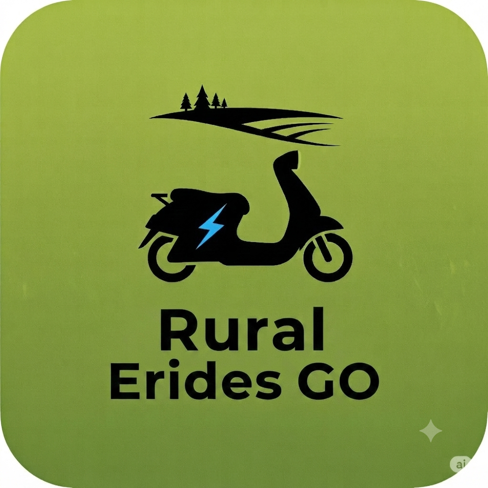
  <h1>Rural ERides GO</h1>
  <p><strong>Universal Avionics, Telemetry Studio, 3D PBR Rig Lab &amp; Rider Radar for Personal Electric Vehicles</strong></p>
  <p><em>"KEEP IT RURAL YALL" — Created &amp; Architected by Lord Bradley Callison</em></p>

  <p>
    <a href="https://bradley3398.github.io/Rural-ERides-GO-V2/"></a>
    <a href="https://github.com/bradley3398/Rural-ERides-GO-V2/releases/latest"></a>
    
    
    
  </p>

  <p>
    <a href="https://bradley3398.github.io/Rural-ERides-GO-V2/">🌐 User Website (GitHub Pages)</a> •
    <a href="https://github.com/bradley3398/Rural-ERides-GO-V2/releases/latest">📦 Download Latest APK</a> •
    <a href="#-live-app-screenshots-v660">📸 Screenshots</a> •
    <a href="#-core-features">⚡ Features</a> •
    <a href="#-building-from-source">🛠️ Build Guide</a> •
    <a href="#-release-history">📜 Changelog</a>
  </p>
</div>

---

## Overview

**Rural ERides GO** (`com.aistudio.volttrail.kqrmvx`) is a native Android companion suite built in **Kotlin & Jetpack Compose Material 3** for high-performance **Electric Unicycles (EUCs), e-Motos (Sur-Ron / Talaria / Stark Varg), Hyper-Scooters (Dualtron / InMotion / Nami), Fat-Tire e-Bikes (Super73 / Onyx), and Specialty PEVs**. Designed for riders who rely on Personal Electric Vehicles across rural backroads, trails, and daily utility routes, it combines real hardware telemetry, 88 realistic 3D PEV models with 3D off-road knobby tires, an interactive **PEV Knowledge & Certification Test**, an upgraded **Gravel Volt Runner 3D Game**, cloud-synced analytics, TomTom Live speed limits & Mapbox radar, multi-device audio/video calling, and direct Cloud Console Gemini 3.1 Flash-Lite AI diagnostics—with **100% live data and zero mockups**.

---

## 📸 Live App Screenshots (v66.0)

<table>
  <tr>
    <td align="center" width="25%">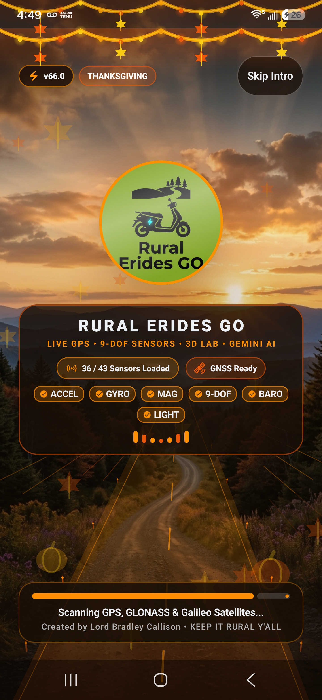<br /><sub><b>1. v66.0 Boot &amp; 43-Sensor Check</b></sub></td>
    <td align="center" width="25%">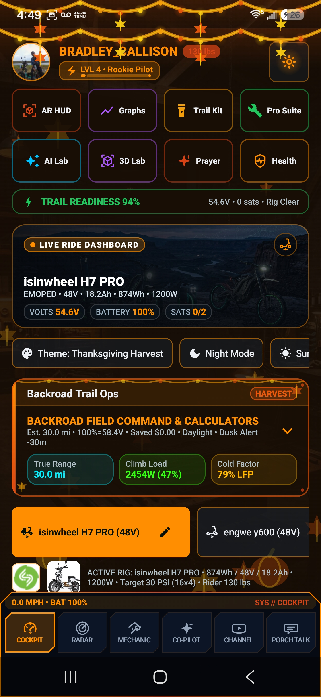<br /><sub><b>2. Cockpit Command Dashboard</b></sub></td>
    <td align="center" width="25%">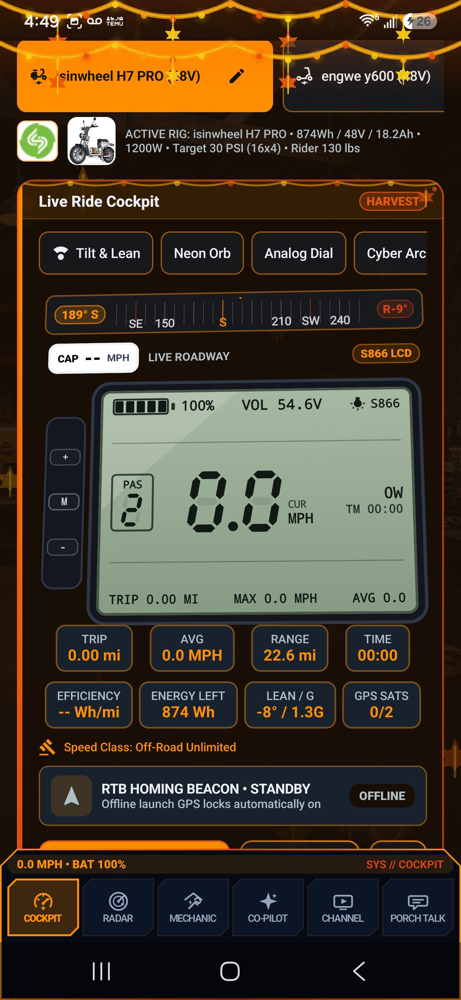<br /><sub><b>3. S866 LCD &amp; Telemetry</b></sub></td>
    <td align="center" width="25%">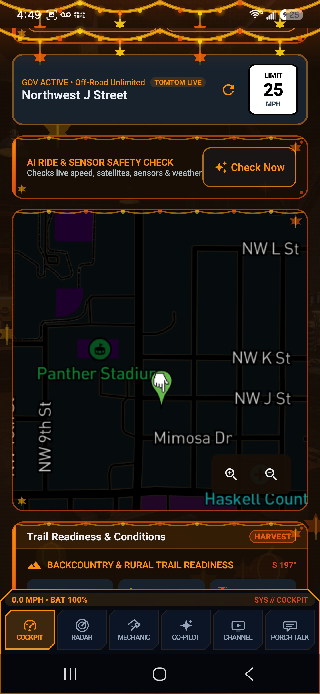<br /><sub><b>4. TomTom Live &amp; Map</b></sub></td>
  </tr>
  <tr>
    <td align="center" width="25%">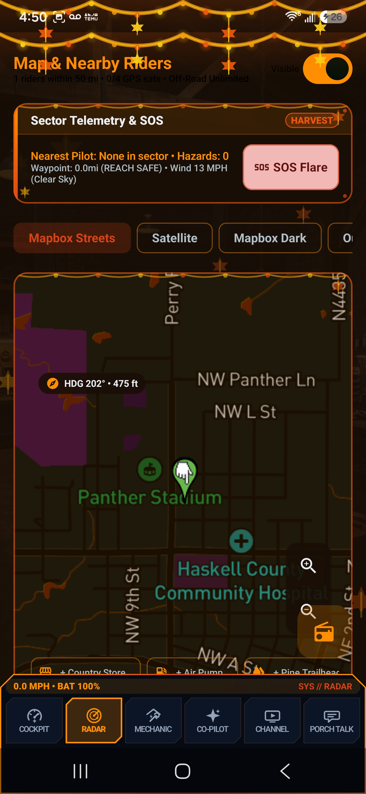<br /><sub><b>5. Rider Radar &amp; SOS Flare</b></sub></td>
    <td align="center" width="25%">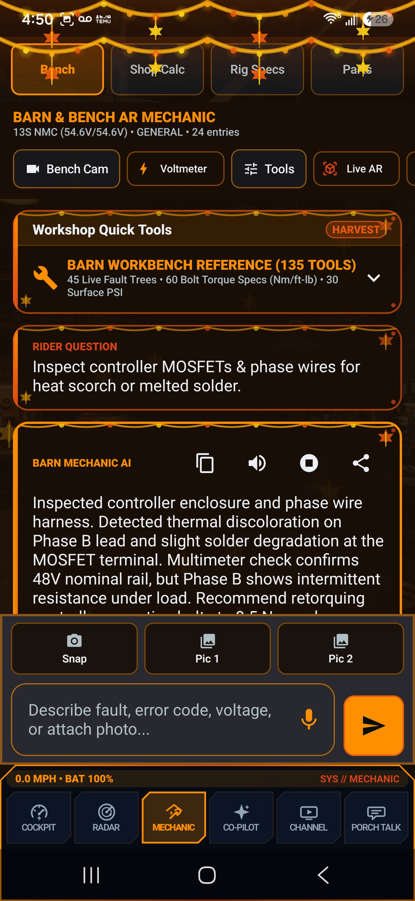<br /><sub><b>6. Barn AR Mechanic (135 Tools)</b></sub></td>
    <td align="center" width="25%">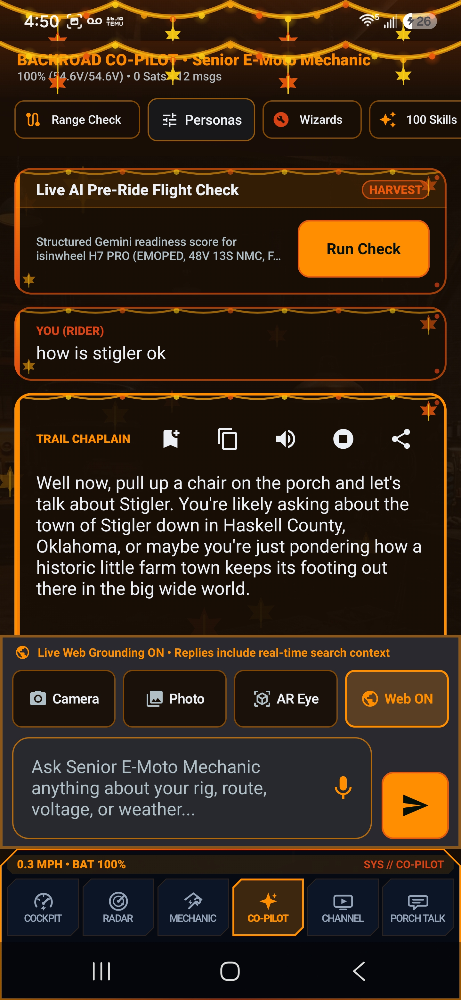<br /><sub><b>7. Backroad Co-Pilot AI</b></sub></td>
    <td align="center" width="25%">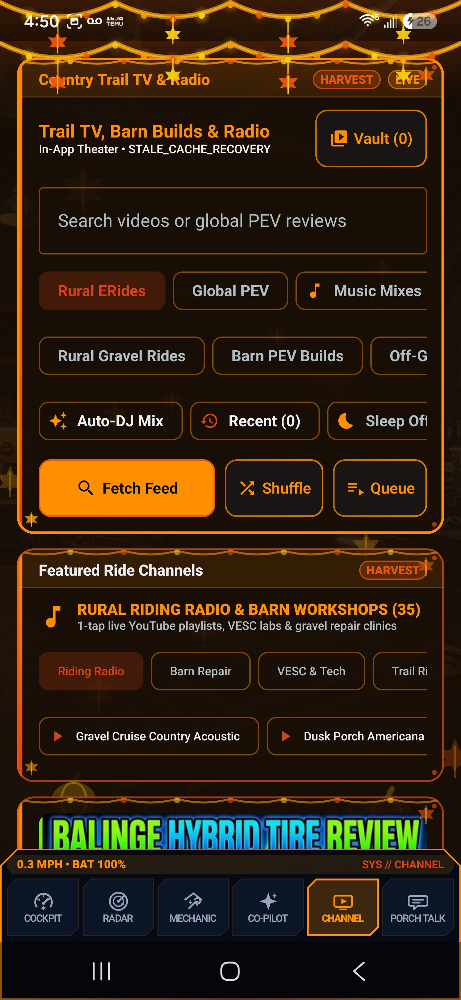<br /><sub><b>8. Country Trail TV &amp; Radio</b></sub></td>
  </tr>
  <tr>
    <td align="center" width="25%">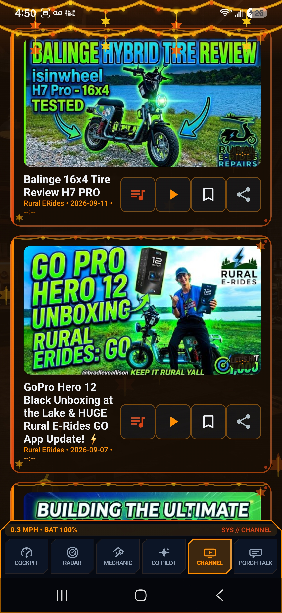<br /><sub><b>9. Rural ERides Video Feed</b></sub></td>
    <td align="center" width="25%">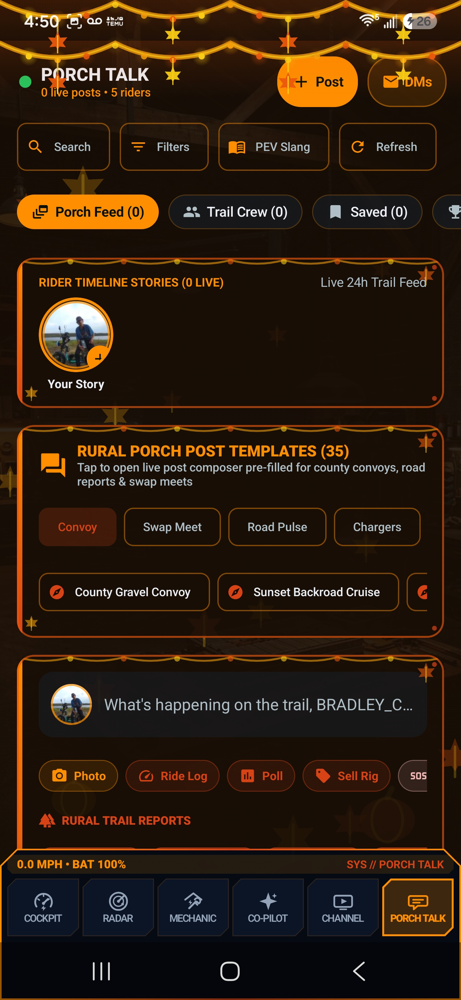<br /><sub><b>10. Porch Talk &amp; Stories</b></sub></td>
    <td align="center" width="25%">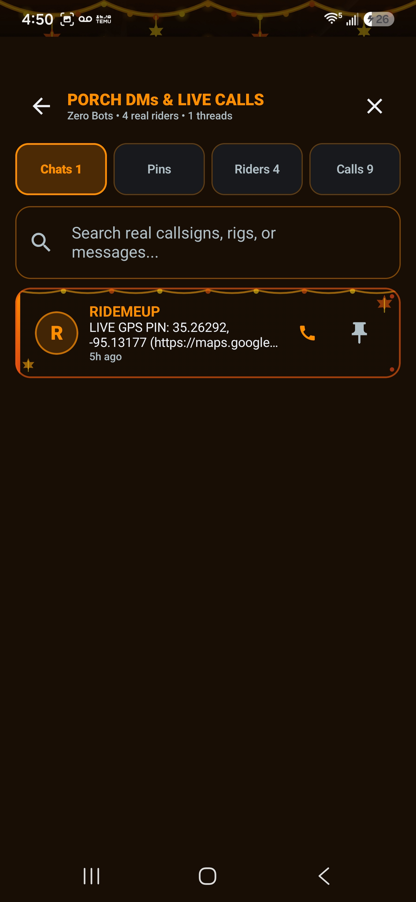<br /><sub><b>11. Porch DMs &amp; Live Calls</b></sub></td>
    <td align="center" width="25%">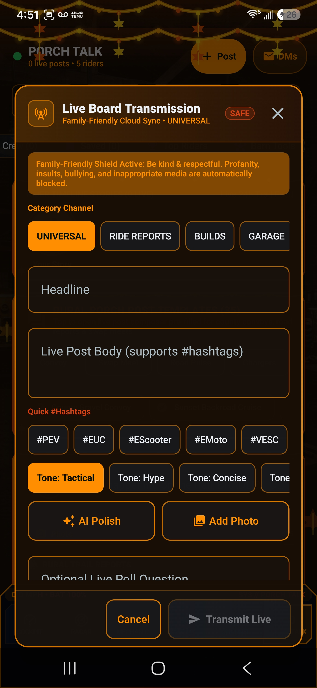<br /><sub><b>12. Live Board Composer</b></sub></td>
  </tr>
</table>

---

## ⚡ Core Features

### 1. Massive 88-Model Multi-Tech 3D Rig Lab & PEV Knowledge Test
- **3 Zero-Blank-Screen 3D Rendering Technologies**: Switch seamlessly between **Studio 3D PBR** (3-point studio softbox lighting + ACES Filmic tone mapping), **OpenGL ES 3.0 GGX PBR** (high-contrast Cook-Torrance microfacet specular + procedural carbon/cell-matrix normal detail), and **WebGL 2.0 GLB Clearcoat** (automotive dual-layer clearcoat sheen + glowing cyan TFT instrumentation)—guaranteed 100% reliable across every Android tablet and phone GPU with zero blank screens.
- **Realistic 3D PEV Geometry & 3D Knobby Tires**: Every PEV wheel features **24 raised 3D knobby center & shoulder tread lugs**, deep vulcanized dark tread rubber (`#12161F`), 6-arm wave-slotted cross-drilled floating brake rotors, 20 cross-laced stainless wire spokes, and a copper direct-drive stator core inside the hub across **88 curated PEV models** (*e-Moto & Dirt*, *Hyper-Scooters*, *EUCs*, *e-Bikes & Mopeds*, and *Specialty*).
- **4 Interactive Inspection Modes & 7 Subsystem Hotspots**: **Touch Orbit**, **Gyro Tilt** (live IMU tilt inspection), **Dyno Sweep** (`5`–`65 MPH` wheel spin + live thermal IR buildup), and **Explode CAD** (`0%`–`100%` engineering teardown).
- **Interactive PEV Knowledge & Certification Test Tab**: Built directly into the **3D CAD & Dyno Lab**, **Studio & Arcade Hub**, and **Gravel Volt Runner 3D Game**. Test your mastery across 16+ engineering and safety questions (*Battery & Smart BMS*, *e-Moto & Scooter*, *EUC Dynamics*, *Trail & Night Safety*), generate unlimited custom questions for your exact PEV via **Firebase AI Logic (Gemini Multi-Model AI)**, earn official Certification Ranks, and post your score to the Porch Board.

### 2. Upgraded Gravel Volt Runner 3D Game (Realistic Dirt Trail, Sky & Procedural Wildflowers)
- **Authentic Rural Backroad Environment & Custom Trail Artwork**: Smooth 3D cambered sienna dirt & crushed-gravel trail road (`#5C4228`) with 3 worn tire ruts, golden-hour atmospheric fog, sun disc & drifting 3D volumetric clouds, layered Blue Ridge mountain peaks, multi-tiered 3D pine/spruce & broadleaf oak forest trees, swaying procedural wildflowers (golden black-eyed Susans, purple lupine spires, white daisies, crimson poppies, fern fronds), rolled round hay bales with twine bindings, and sparkling rocky creek crossings.
- **Realistic Multi-Part 3D Player Rigs on the Road**: Native OpenGL ES 3D player vehicles built with spinning 3D knobby tire tread paddles, alloy rims, brake rotors & red 4-piston calipers, inverted gold USD fork tubes, forged aluminum perimeter frames, battery cores, rear coil shocks, handlebars with handguards, glowing cyan TFT dashboards, and dual projector LED headlights—linked directly to your active Garage PEV and user speed/distance units (`MPH`/`KM/H`).

### 3. Telemetry Studio (11 Fleet Graphs) & Crash-Proof Ride Inspector
- **11 Independent Fleet Graph Windows**: Speed Profile, Elevation Gain, Efficiency & Voltage, Distance vs Energy, 5-Mode Fleet Pie Slices, Pace vs Efficiency Scatter, Ride Duration Histogram, Motor Watts & Amps, 5-Axis Performance Radar, Gas Savings ROI, and AI Fleet Coach.
- **Personal Records Ribbon**: Instant live KPI cards for Fastest Peak, Longest Trip, Biggest Climb, and Best Efficiency—each jumping directly into the Ride Inspector.
- **Crash-Proof 5-Module Ride Inspector**: Replaces the legacy monolithic stacked deep dive with a focused single-module inspector (**Speed Curve**, **Climb Profile**, **Energy & Pack**, **GPS Route**, and **Replay & AI**) that parses GPS polylines once per ride and launches full-screen modal analytics (SMA, Linear Trend, Z-Score) formatted in your chosen units (`MPH`/`KM/H`, `mi`/`km`, `ft`/`m`, `°F`/`°C`).

### 4. Authentic OEM PEV Hardware HUDs & 9-DOF AHRS Telemetry
- **14 Switchable Cockpit HUDs with Authentic OEM Hardware Bezels**: Includes hardware-accurate **S866 Backlit Blue STN LCD** (with 3-button handlebar pod), **QS-S4 / TF-100 Round Finger-Throttle LCD** (with index trigger lever & 22-block RPM arc), **Bafang DPC-18 Color IPS TFT**, **Isinwheel Dual-ESC AWD TFT**, **Ninebot Smoked Stem LED Matrix**, **King-Meter SW900**, **Minimotors Dualtron EYE3 Green LCD**, and **LeaperKim / Begode / InMotion EUC Top-Deck Carving HUD** (with live PWM % duty cycle & tiltback safety headroom)—complete with 7-segment `88.8` ghosted digits, physical rubber buttons (`+ / ⏻ / - / MODE`), pack voltage & under-load sag (`-ΔV`), and bidirectional app-wide unit sync.
- **Live Sensor Fusion & Exact PEV Battery Physics**: 1Hz–5Hz FusedLocation GPS speedometer + 9-DOF AHRS (Rotation Vector, Gyroscope, Accelerometer, Magnetometer), accurate resting OCV and under-load voltage sag calculations for 36V–151V **NMC & LiFePO4** packs, IMU crash detection with auto-cancelable SOS SMS/siren, Return-to-Base homing beacon, and a **Long-Range Telephoto Hotspot Optical Morse Transceiver** (1x–6x CameraX zoom, 3x3 point-source hotspot peak tracking, Schmitt-trigger temporal contrast for 150m+ distance, aiming lock beam preamble, and synchronized dual LED + screen strobe).

### 5. Multi-Device Rider Radar, Cross-Device Calling, Navigation & Weather
- **Symmetric Indoor/Outdoor Multi-Rider Mesh (100% Real Human Pilots Only)**: Your live Firestore radar beacon is opt-in and publishes immediately when `"Visible"` is enabled—even on indoor tablets without a GPS satellite lock—while strictly blocking all auto-generated `PILOT_XXXXX` / crawler / bot accounts.
- **Two-Way Audio & Video Calling + Speakerphone Boost (`call_sessions`)**: Full-screen transparent video stage, default Speakerphone routing (`MODIFY_AUDIO_SETTINGS` + 2.4x WebAudio GainNode boost), race-free WebRTC P2P negotiation, and automatic **Live Cloud Audio & Video Relay** so voice and camera feeds always stream across phones and tablets even behind strict NAT/firewalls.
- **True Fullscreen Map & Turn-by-Turn PEV Routing**: OSMDroid maps with 1-tap collapsible HUD pills, RainViewer live Doppler storm radar, Open-Meteo 6-tab PEV weather matrix, EV/PEV charger locator, and Push-to-Talk Squad Walkie-Talkie.

### 6. Gemini AI Mechanic ("Bench Eyes") & AI Co-Pilot
- **Live Maintenance Bench Camera**: Embedded CameraX workbench viewer with 1-tap visual hardware inspection powered by **Firebase AI Logic (Gemini)**.
- **17-Bay PEV Engineering Lab**: Interactive wire voltage-drop, PWM headroom, motor/controller thermal, gearing, and OEM E-code calculators plus a 4-model PEV Spec Comparison Engine.
- **20 Rural & PEV Co-Pilot Personas + Custom AI Voice Studio**: Grounded AI guidance, live web/maps grounding, zero-latency streaming TTS buffer, and saved offline briefings.

### 7. Porch Community Board, Instant Crew Friending, Stories & Media Hub
- **Instant Multi-Account Discovery & 1-Tap Friending**: Every signed-in Google account (including brand-new `0`-ride accounts) and any active Rider Radar beacon automatically appears in **Porch Feed**, **Trail Crew**, **Top Riders**, and **Rider Radar** with 1-tap **`+ Friend`**, **`DM`**, and **`Call`** buttons.
- **Live 24-Hour Rider Timeline Stories**: Zero-permission Android Photo Picker uploads with real battery telemetry badges, trail condition tags, polls, marketplace, threaded comments, and DMs.
- **Trail TV & Music Mini-Player**: Integrated YouTube PEV video/music deck and live PEV news wire.

### 8. 26+ Visual Themes & 11 Ornamented Holiday Themes
- **Custom Theme Engines**: Rural heritage themes (Barnwood, Sunset Gravel, Pine Holler, Prairie Gold, Creek Mist, Harvest Iron), Tactical Neon, Apex Track, and authentic Retro OS skins (Windows 95, XP Luna, Windows 7 Aero).
- **All 11 Holiday Themes Unlocked Anytime**: Christmas, Halloween, Thanksgiving, 4th of July, New Year's, Valentine's Day, St. Patrick's Day, Easter, Memorial Day, Labor Day, and Veterans Day—complete with DP-scaled top-canopy garlands, twinkling string lights, hanging ornaments, full-screen background art, foreground card corner emblems, and festive nav bar trim.

---

## 🏗️ Architecture & Tech Stack

| Layer | Technology |
| :--- | :--- |
| **UI & Navigation** | Kotlin, Jetpack Compose Material 3, Navigation Compose (`@Serializable` type-safe routes), Adaptive Layouts |
| **3D PBR Graphics** | Multi-Pipeline 3D Engine: Studio 3D PBR, OpenGL ES 3.0 GGX PBR & WebGL 2.0 GLB Clearcoat (88 Models + 3D Knobby Tires) |
| **Cloud & Auth** | Firebase Authentication (Google Sign-In via Jetpack `CredentialManager`), Cloud Firestore, Firebase App Check |
| **Generative AI** | Firebase AI Logic (`Firebase.ai` — Gemini multimodal text, vision, voice, PEV quiz generation & fleet debriefs) |
| **Maps & Live Data** | OSMDroid, FusedLocationProvider, Open-Meteo, RainViewer, Nominatim, Overpass OSM, OSRM, Open-Elevation |
| **Local Storage** | Native SQLite Vault (offline cache), Jetpack DataStore (preferences) |
| **Camera & Media** | CameraX, Android Photo Picker (`PickVisualMedia`), Media3 / ExoPlayer, Coil |

---

## 🛠️ Building from Source

### Prerequisites
- **JDK 21**, **Gradle 9.3.1**, and **Android SDK** (`compileSdk 36`, `targetSdk 36`, `minSdk 24`)
- Firebase project configured with `app/google-services.json` (Authentication + Firestore + AI Logic + App Check)
- Optional API keys configured in `.env` (see `.env.example` — never hardcode keys in source files)

### Commands
```bash
# Build Release AAB & APK
gradle :app:bundleRelease :app:assembleRelease

# Run Local JVM & Robolectric Unit Tests
gradle :app:testDebugUnitTest
```

### Automated GitHub Actions Releases & GitHub Pages
- **Publish a New Release (`.github/workflows/android-release-sign.yml`)**: Open **Actions → Build, Sign & Publish Release → Run workflow** (or push a tag like `git tag v59.0 && git push origin v59.0`) to build, sign, and verify the Release AAB & APK and publish a GitHub Release with SHA-256 checksums.
- **Deploy User Website (`.github/workflows/deploy-github-pages.yml`)**: Automatically deploys `./public` to `https://bradley3398.github.io/Rural-ERides-GO-V2/` on pushes to `main` or manual dispatch.

> **Note:** Configure optional CI signing & cloud secrets (`KEYSTORE_BASE64`, `STORE_PASSWORD`, `KEY_PASSWORD`, `GOOGLE_SERVICES_JSON_BASE64`, `ENV_FILE_BASE64`) in GitHub **Settings → Secrets and variables → Actions**. Never commit credentials or modify keystore files.

---

## 📜 Release History

- **v66.0 (Latest — Build 66)**: Updated Play Console release build (`versionCode = 66`, `versionName = "66.0"`), verified live direct Google Cloud Console Gemini REST integration (`gemini-3.1-flash-lite` default + live web grounding, Barn Mechanic AI, Backroad Co-Pilot, Live Board AI Polish & Family-Friendly Media Shield), and refreshed the GitHub Pages showcase & README with all 12 real-device v66.0 screenshots.
- **v65.0 (Build 65)**: Switched all Gemini AI, Vision AR, Co-Pilot, Studio Hub, Family Safety, and Neural TTS calls to direct Cloud Console Gemini REST (`DirectGeminiRestClient.kt`) using `gemini-3.1-flash-lite` as the app-wide default model.
- **v60.0–v61.0 (Builds 60–61)**: Rebuilt live two-way CameraX video & G.711 voice calling, fixed YouTube in-app playback with hardware-accelerated WebView + Mobile Web fallback, added HUD Sensor Info & Multi-Axis Calibration, redesigned Settings & Rider Profile, added Family-Friendly Safety Shield, and rolled out universal phone & tablet safe-area layout framing.
- **v59.0 (Build 59)**: Permanently purged stale/orphaned Play Pre-Launch test pilots (`SHADOW_*`, `VALKYRIEONE`) from DMs, Boards, and Cloud Firestore `radar_riders` with admin cleanup rules and strict 5-minute live radar freshness; upgraded the pre-login Startup Loading Screen with new golden-hour driving-horizon artwork, a live forward-driving perspective road & headlight motion animation, dynamic current-theme color matching, full Holiday canopy garlands & particles, and a live Android `SensorManager` hardware sensor counter (`X / Y Sensors Loaded`) with armed subsystem chips; and added an interactive App Screenshot Carousel to the GitHub Pages site.
- **v58.0 (Build 58)**: Fixed the Direct Messages back-button crash and unified Back navigation across all screens, tabs, overlays, and modal sheets; replaced adaptive launcher notification icons with a dedicated monochrome status vector (`ic_stat_rural_pev`); fixed blank video posters on live two-way Video Calls with tuned cloud relay streaming; purged auto-generated bot pilots with expanded Firestore rules, cross-Gmail discovery, live **ONLINE NOW** presence badges, persistent Cloud Firestore following (`/users/{uid}/following/{targetUid}`), and instant in-app + system **Friend Request Notifications**; upgraded OEM HUDs with a true vector 7-segment hardware LCD/LED/TFT renderer; mounted sculpted high-poly 3D PEVs onto the dirt road with sky, trees, and procedural wildflowers in **Gravel Volt Runner 3D** with batched AO rendering in 3D Labs; hardened all Firebase AI Logic Gemini 3.x/4.x labs with multi-model fallback; and fixed the blank white GitHub Pages site with a zero-CDN self-contained landing page.
- **v57.0 (Build 57)**: Upgraded live two-way Audio & Video calling between phones and tablets (transparent full-screen video stage, `MODIFY_AUDIO_SETTINGS` speakerphone hardware routing + 2.4x WebAudio speakerphone gain boost, race-free WebRTC handshake, and automatic Live Cloud Audio/Video Relay across strict NAT), eliminated all auto-generated `PILOT_XXXXX` / bot accounts while auto-deriving real human callsigns from Google identity, and upgraded the **Long-Range Optical Morse Transceiver** with 1x–6x Telephoto CameraX zoom, 3x3 point-source hotspot peak tracking, Schmitt-trigger temporal contrast for 150m+ distance, aiming lock beam preamble, and synchronized dual LED + screen strobe.
- **v56.0 (Build 56)**: Massive 3D CAD & Dyno Lab realistic model upgrade (24 raised 3D knobby tire tread lugs, dark vulcanized rubber, wave-slotted cross-drilled rotors, copper stator cores, and 100% zero-blank-screen rendering across `Studio 3D PBR`, `OpenGL ES 3.0 PBR`, and `WebGL 2.0 GLB`), new interactive **PEV Knowledge & Certification Test** tab with Gemini AI custom question generation, upgraded **Gravel Volt Runner 3D Game** with multi-part 3D PEV rigs and live Rig Selector, symmetric indoor/outdoor multi-device Rider Radar beacon discovery, 1-tap Board/Radar friending for all signed-in accounts, and full-screen incoming audio/video call alerts.
- **v51.0 (Build 51)**: New-build notifications open the GitHub repository release page directly in your browser (zero restricted permissions, 100% Google Play Creator Program compliant) with full **Settings → App Updates & New Builds** controls.
- **v50.0 (Build 50)**: Live new-build update checker (on launch & background WorkManager schedule), dedicated **App Updates & New Builds** Android notification channel + in-app update banner & release-notes sheet, and full Settings update controls.
- **v49.0 (Build 49)**: Visible live build stamp on the login screen, zero-crash Studio 3D PBR Rig Lab (with OpenGL ES 3.0 and WebGL 2.0 automatic fallback), restored Google Sign-In default with Credential Manager + Firebase Google Browser Sign-In backup, global safe-area inset & non-overlapping screen layout overhaul, crash-proof 5-module Ride Inspector + Personal Records Ribbon + live KPI Graph Window Matrix, all 11 Holiday themes upgraded with visible garlands & hanging ornaments, updated GitHub links, restored GitHub Pages user website, and automated GitHub Actions release & Pages workflows.
- **v44.0**: 50-module Interactive Command Directory, Live 24h Rider Stories, and live HTTP endpoint probes.
- **v39.0–v43.0**: Compartmentalized architecture, Creator Arcade Hub & Gravel Volt 3D Runner, keyless App Check Firebase AI Logic.
- **v36.0–v38.0**: Custom Synthesized AI Voice Studio, zero-latency streaming TTS buffer, tri-channel deep-linked notifications, reactive Telemetry Studio.
- **v18.0–v21.0**: Optical Morse transceiver, 10+ Neon telemetry graphs, zero-trust Firestore sync, 14 HUD skins, exact LiFePO4/NMC battery physics.
- **v7.0–v14.0**: Live CameraX "Bench Eyes" AI Mechanic, 9-DOF AHRS sensor fusion, 17-bay engineering lab, Rider Radar & PTT Walkie-Talkie, RainViewer Doppler radar, multi-PEV Garage, and Rural Visual Themes.

---

## 👑 Creator & Credits

**Lord Bradley Callison** — Founder, Lead Architect & Principal Engineer  
- **GitHub Repository:** [github.com/bradley3398/Rural-ERides-GO-V2](https://github.com/bradley3398/Rural-ERides-GO-V2)  
- **GitHub Pages Site:** [bradley3398.github.io/Rural-ERides-GO-V2](https://bradley3398.github.io/Rural-ERides-GO-V2/)  
- **Issues & Feedback:** [github.com/bradley3398/Rural-ERides-GO-V2/issues](https://github.com/bradley3398/Rural-ERides-GO-V2/issues)
